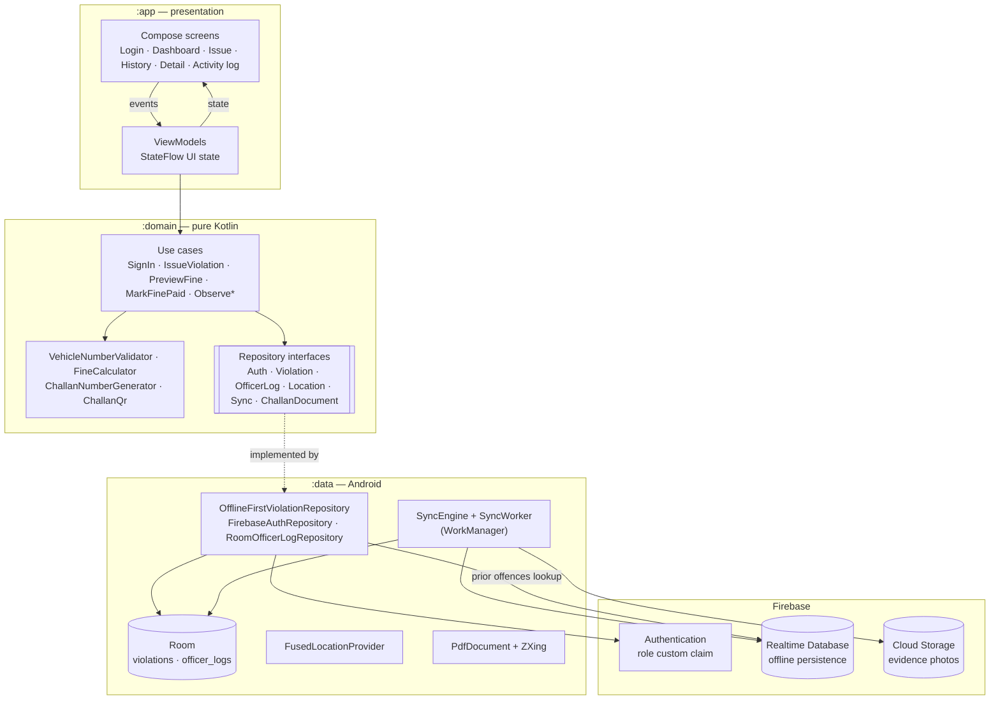
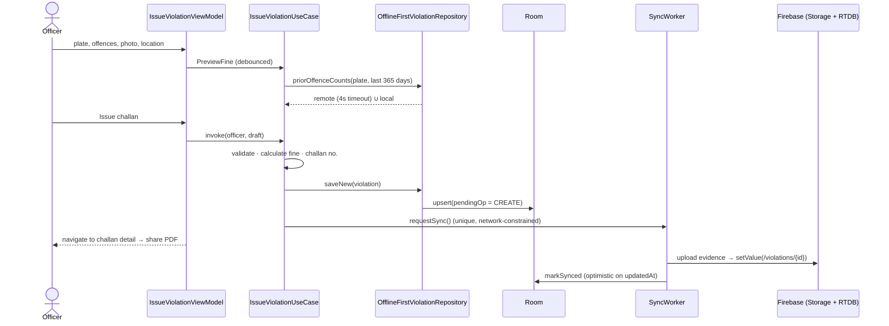

# Traffic Violation & Fine Manager (e-Challan)

[](https://github.com/srini2k03/traffic-violation-fine-manager/actions/workflows/android-ci.yml)


[](LICENSE)

A native Android app that lets traffic police officers **issue digital violation notices (e-challans) in real time** —
even with no network — and keeps officer activity logs and violation history securely in Firebase.

> Originally built in September 2023 as a Kotlin + Firebase project; this repository is the
> re-architected "advanced" version (Clean Architecture, Compose, offline-first sync).

---

## Table of contents

- [Features](#features)
- [Architecture](#architecture)
- [Data model](#data-model)
- [Security rules](#security-rules)
- [Getting started](#getting-started)
- [Testing & CI](#testing--ci)
- [Screenshots](#screenshots)
- [Tech stack](#tech-stack)
- [Project structure](#project-structure)
- [Roadmap](#roadmap)
- [License](#license)

## Features

| Area | What it does |
| --- | --- |
| **Officer login** | Firebase email/password auth. The `role` custom claim (`officer` / `admin`) gates access; accounts without a role are rejected. Last verified profile is cached so an officer can keep working offline. |
| **Dashboard** | Today's challans, fines issued, amount collected, pending dues, top offences, unsynced count and a manual "sync now". Admins see the whole station, officers see their own work. |
| **Issue violation** | Indian plate validation (state series incl. `DL 3C AF 0001`, and Bharat `22 BH 1234 AB`), offence catalogue with MV Act sections and fines, GPS location via `FusedLocationProviderClient` + reverse geocoding, evidence photo via the Activity Result API (`TakePicture`), offender details, notes. |
| **Fine calculation** | Integer-rupee calculator with a **repeat-offender multiplier** (×1.0 → ×1.5 → ×2.0 for prior offences of the same type in the last 365 days, per-line cap). Prior offences are looked up remotely by plate with a local fallback when offline. Live, debounced preview while the form is filled. |
| **e-Challan PDF** | A4 challan / receipt rendered with `android.graphics.pdf.PdfDocument`, with a **ZXing QR code** pointing to a verification URL (no personal data in the QR), shared via `FileProvider` + share sheet. |
| **History** | Search by plate or challan number, filter by status (pending / paid / cancelled) and date range (today, 7 days, 30 days, all), running total. |
| **Mark fine paid** | Cash / UPI / card / online with transaction reference validation; recorded offline and synced as a minimal multi-path update permitted by the rules. |
| **Activity log** | Append-only officer log (sign-in/out, challan issued, fine collected, challan shared, challan cancelled) grouped by day. |
| **Admin console** | For `role = admin`: analytics over 7 / 30 / 90 days with **hand-drawn Compose Canvas charts** (daily issued-vs-collected bars, status donut, offence-category and top-offence bars, officer leaderboard), KPIs (collection rate, repeat-offender share), and **officer management** (live officer directory, activate/deactivate accounts, per-officer performance). Admins can also cancel pending challans with a recorded reason. |
| **Profile & settings** | Officer profile (badge, station, role), sync status with pending-change count and "sync now", password-reset email, link to the activity log, app version, and sign-out with a warning when changes are still unsynced. |
| **Offline-first** | Room is the single source of truth; every write is queued with a pending-operation marker and pushed by a Hilt-injected **WorkManager** worker (network-constrained, exponential backoff, periodic safety net). Firebase RTDB offline persistence is enabled as well. |

## Architecture

Three Gradle modules following Clean Architecture + MVVM:

- **`:domain`** — pure Kotlin/JVM. Models, the offence catalogue, validators, `FineCalculator`, challan number & QR payload generators, repository interfaces and use cases. No Android dependency → fast unit tests.
- **`:data`** — Android library. Room, Firebase (Auth, Realtime Database, Storage), WorkManager sync, location and PDF generation. Implements the domain interfaces; wired with Hilt.
- **`:app`** — Jetpack Compose + Material 3 UI, type-safe Navigation Compose, `@HiltViewModel`s exposing `StateFlow` UI state.



### Issue-violation flow (offline-first)



## Data model

Realtime Database tree (see [`firebase/sample-data.json`](firebase/sample-data.json)):

```jsonc
{
  "officers": {
    "<uid>": { "name": "Insp. Priya Raman", "email": "priya@tnpolice.gov.in", "role": "officer", "badgeNumber": "TNP-4821", "station": "Adyar Traffic", "active": true }
  },
  "violations": {
    "<violationId>": {
      "challanNumber": "EC-TN-20230915-4821-K7Q2XM",
      "vehicleNumber": "TN09AB1234",              // normalised, no spaces
      "offenderName": "Ravi Kumar",
      "offenderPhone": "9876543210",
      "fine": {
        "total": 6500,                             // whole rupees
        "lines": {
          "NO_LICENCE": { "title": "...", "section": "181",  "baseAmount": 5000, "priorOffences": 0, "multiplierPercent": 100, "amount": 5000 },
          "NO_HELMET":  { "title": "...", "section": "194D", "baseAmount": 1000, "priorOffences": 1, "multiplierPercent": 150, "amount": 1500 }
        }
      },
      "location": { "lat": 13.0067, "lng": 80.257, "accuracy": 8.5, "address": "LB Road, Adyar, Chennai" },
      "evidencePhotoUrl": "https://firebasestorage.googleapis.com/...",
      "notes": "...",
      "officerId": "<uid>", "officerName": "...", "officerBadge": "TNP-4821",
      "issuedAt": 1694752200000,
      "status": "PENDING | PAID | CANCELLED",
      "payment": { "mode": "CASH | UPI | CARD | ONLINE", "reference": "UPI-778123456", "paidAt": 1694755800000, "collectedBy": "<uid>" },
      "cancelReason": "Duplicate entry",          // admins only, when status = CANCELLED
      "updatedAt": 1694755800000
    }
  },
  "officerLogs": {
    "<uid>": {
      "<logId>": { "action": "VIOLATION_ISSUED", "details": "EC-TN-... · TN 09 AB 1234 · ₹6500", "referenceId": "<violationId>", "timestamp": 1694752201000 }
    }
  }
}
```

Storage: `evidence/{violationId}/{file}.jpg` (down-sampled to ≤1600 px, JPEG 80 before upload).

Locally, Room mirrors `violations` (plus a `pendingOp` column: `CREATE` / `UPDATE_PAYMENT` / `null`) and `officer_logs` (plus `pending`).

## Security rules

Roles are **Firebase Auth custom claims** (`auth.token.role`), set only from a trusted environment with the Admin SDK
([`scripts/set-role.mjs`](scripts/set-role.mjs)) — a client can never grant itself a role.

[`firebase/database.rules.json`](firebase/database.rules.json):

| Path | Read | Write |
| --- | --- | --- |
| `/` | denied | denied (default deny) |
| `/officers/{uid}` | the officer themself or an admin | admins only (profile, `role` mirror, `active` flag) |
| `/violations` | any officer/admin (needed for repeat-offender lookups); indexed on `vehicleNumber`, `officerId`, `updatedAt`, `issuedAt`, `challanNumber` | — |
| `/violations/{id}` | — | **create only** by an *active* officer for themselves (`!data.exists() && officerId == auth.uid && officers/{uid}/active != false`); admins may edit/cancel (`cancelReason` is admin-only) |
| `/violations/{id}/status` | — | officer/admin may change `PENDING → PAID` only |
| `/violations/{id}/payment` | — | officer/admin may add once while status is `PENDING`; `collectedBy` must be the caller |
| `/violations/{id}/updatedAt` | — | officer/admin, while `PENDING`, monotonic |
| `/officerLogs/{uid}/{logId}` | owner or admin | owner only, **append-only** (`!data.exists()`) |

Every field is validated: plate regex (state & BH series), challan-number format, phone format, enum values, numeric
ranges, string lengths, immutability of `challanNumber` / `officerId` / `issuedAt`, `amount ≥ baseAmount`,
timestamps not in the future, and `$other: false` to reject unknown keys.

[`firebase/storage.rules`](firebase/storage.rules): evidence readable by officers/admins; uploads must be images
< 5 MB with a safe file name; overwrite allowed only within an hour of creation (upload retries); delete is admin-only;
everything else denied.

Deploy both with the Firebase CLI: `firebase deploy --only database,storage`.

## Getting started

### Prerequisites

- Android Studio Ladybug (2024.2) or newer, JDK 17
- A Firebase project (Spark plan is enough)

### 1. Firebase project

1. Create a project in the [Firebase console](https://console.firebase.google.com/).
2. **Authentication → Sign-in method →** enable *Email/Password*.
3. **Realtime Database →** create a database (e.g. `asia-southeast1`) in *locked mode*.
4. **Storage →** get started.
5. Deploy the rules from this repo:
   ```bash
   npm i -g firebase-tools
   firebase login
   firebase use --add            # pick your project
   firebase deploy --only database,storage
   ```

### 2. Register the Android app + SHA fingerprints

1. **Project settings → Your apps → Add app → Android** with package `com.srini.trafficfine`
   (add `com.srini.trafficfine.debug` too for debug builds).
2. Add your SHA-1 / SHA-256 fingerprints:
   ```bash
   ./gradlew signingReport
   # or: keytool -list -v -keystore ~/.android/debug.keystore -alias androiddebugkey -storepass android -keypass android
   ```

### 3. `google-services.json`

Download `google-services.json` and place it at **`app/google-services.json`**.
It is listed in `.gitignore` and must **never** be committed —
[`app/google-services.json.example`](app/google-services.json.example) shows the expected shape only.

The Google Services Gradle plugin is applied **only when that file exists**, so the project still builds (lint and
unit tests) without it, which is how CI runs. A build without the file will crash on launch because Firebase is not
initialised.

### 4. Create officer accounts

1. **Authentication → Users → Add user** (email + password).
2. Give the user a role and profile with a service-account key:
   ```bash
   cd scripts && npm install
   export GOOGLE_APPLICATION_CREDENTIALS=/path/to/service-account.json
   export FIREBASE_DATABASE_URL=https://<project>-default-rtdb.<region>.firebasedatabase.app
   node set-role.mjs priya@tnpolice.gov.in officer "Insp. Priya Raman" TNP-4821 "Adyar Traffic"
   node set-role.mjs admin@tnpolice.gov.in admin   "SI Admin"          TNP-0001 "Adyar Traffic"
   ```

### 5. Build & run

```bash
./gradlew installDebug
```

> **Gradle wrapper:** `gradlew`, `gradlew.bat`, `gradle/wrapper/gradle-wrapper.jar` and
> `gradle-wrapper.properties` (Gradle 8.11.1) are committed. If the jar is ever missing, regenerate it with a local
> Gradle install: `gradle wrapper --gradle-version 8.11.1`.

## Testing & CI

```bash
./gradlew :domain:test            # pure JVM: validators, fine calculator, use cases (no Android SDK needed)
./gradlew testDebugUnitTest       # app ViewModels + data mappers
./gradlew lint testDebugUnitTest :domain:test   # what CI runs
```

| Suite | Covers |
| --- | --- |
| `VehicleNumberValidatorTest` | state series, BH series, Delhi-style series, normalisation, every rejection reason |
| `FineCalculatorTest` | base fines, multi-offence totals, repeat-offender tiers, per-line cap, half-up rounding, policy invariants |
| `ViolationFormValidatorTest`, `FieldValidatorsTest` | form errors, mandatory photo evidence, Indian mobile numbers, credentials |
| `IssueViolationUseCaseTest`, `MarkFinePaidUseCaseTest`, `SignInUseCaseTest` | orchestration with MockK: normalisation, repeat-offender pricing, logging, sync requests, failure paths |
| `ChallanNumberGeneratorTest`, `ChallanQrTest`, `DashboardStatsTest` | challan format, QR payload privacy, dashboard aggregation & history filter |
| `LoginViewModelTest`, `IssueViolationViewModelTest`, `HistoryViewModelTest`, `ActivityLogViewModelTest` | UI state with Turbine + coroutines-test (debounced fine preview, validation errors, filters) |
| `AnalyticsSummaryTest`, `PriorOffenceCounterTest`, `AdminUseCasesTest` | admin analytics windows and aggregation, prior-offence de-duplication, admin-only cancellation and officer activation |
| `AdminViewModelTest`, `ViolationDetailViewModelTest` | analytics range switching, officer list errors, activation feedback, payment / PDF share / cancellation flows |
| `MappersTest` (data) | Room entity and Realtime Database map round-trips (incl. cancellation), malformed node handling |

GitHub Actions ([`.github/workflows/android-ci.yml`](.github/workflows/android-ci.yml)) runs on JDK 17:
rules JSON validation → `./gradlew lint testDebugUnitTest :domain:test` → uploads reports.
No secrets are required; optionally store a base64 `GOOGLE_SERVICES_JSON` secret to build with real config.

## Screenshots

| Login | Dashboard | Issue challan | Challan PDF |
| --- | --- | --- | --- |
| _`docs/screenshots/login.png`_ | _`docs/screenshots/dashboard.png`_ | _`docs/screenshots/issue.png`_ | _`docs/screenshots/challan-pdf.png`_ |

_Screenshots to be added._

## Tech stack

| Layer | Libraries |
| --- | --- |
| Language & build | Kotlin 2.1, Gradle Kotlin DSL, version catalog (`gradle/libs.versions.toml`), AGP 8.7, KSP |
| UI | Jetpack Compose (BOM 2024.12), Material 3, Navigation Compose (type-safe routes), Coil, SplashScreen |
| Architecture | Clean Architecture, MVVM, Hilt (+ hilt-navigation-compose, hilt-work), Coroutines & Flow |
| Backend | Firebase Authentication (custom claims), Realtime Database (offline persistence), Cloud Storage |
| Local / background | Room, WorkManager, kotlinx.serialization |
| Device | Fused Location Provider, Geocoder, Activity Result API (camera), `PdfDocument`, ZXing, `FileProvider` |
| Testing | JUnit 4, MockK, Turbine, kotlinx-coroutines-test |
| CI | GitHub Actions |

## Project structure

```
traffic-violation-fine-manager/
├── app/                                   # :app — Compose UI (com.srini.trafficfine)
│   ├── google-services.json.example       # placeholder; real file is git-ignored
│   └── src/
│       ├── main/java/.../
│       │   ├── TrafficFineApp.kt          # @HiltAndroidApp, WorkManager + HiltWorkerFactory
│       │   ├── MainActivity.kt
│       │   ├── ui/{login,dashboard,issue,history,detail,activitylog,profile,admin}/   # Screen + ViewModel
│       │   ├── ui/admin/Charts.kt         # Canvas bar / donut / horizontal-bar charts
│       │   ├── ui/{navigation,components,theme}/
│       │   └── util/                      # formatters, FileProvider sharing
│       └── test/                          # ViewModel tests
├── data/                                  # :data — Android library
│   └── src/main/java/.../data/
│       ├── local/                         # Room entities, DAOs, mappers
│       ├── remote/                        # RTDB data source, Storage uploader, JSON mappers
│       ├── repository/                    # Offline-first + Firebase Auth repositories
│       ├── sync/                          # SyncEngine, SyncWorker, WorkManagerSyncScheduler
│       ├── location/  pdf/  session/  di/
├── domain/                                # :domain — pure Kotlin
│   └── src/main/kotlin/.../domain/
│       ├── model/  validation/  fine/  usecase/  repository/  util/
├── firebase/
│   ├── database.rules.json
│   ├── storage.rules
│   └── sample-data.json
├── scripts/set-role.mjs                   # Admin SDK: role claim + officer profile
├── firebase.json                          # rules deploy + emulator config
├── .github/workflows/android-ci.yml
└── gradle/libs.versions.toml
```

## Roadmap

- [ ] Rules unit tests with the Firebase Emulator Suite (`@firebase/rules-unit-testing`) in CI
- [ ] Compose UI tests and screenshot tests
- [ ] Online payment link (UPI intent / payment gateway) in the challan QR
- [ ] Vahan / Sarathi integration for owner lookup by registration number
- [ ] ANPR: plate recognition from the evidence photo with ML Kit text recognition
- [ ] Officer onboarding from the admin console via a callable Cloud Function (Admin SDK)
- [ ] Dispute workflow for offenders
- [ ] Localised strings (Tamil, Hindi) and state-specific fine schedules
- [ ] App Check + Play Integrity to protect the backend from non-genuine clients

## License

[MIT](LICENSE) © 2023 Srinivasan Balasubramanian

> Fine amounts are indicative values based on the Motor Vehicles (Amendment) Act, 2019 and are not legal advice.
